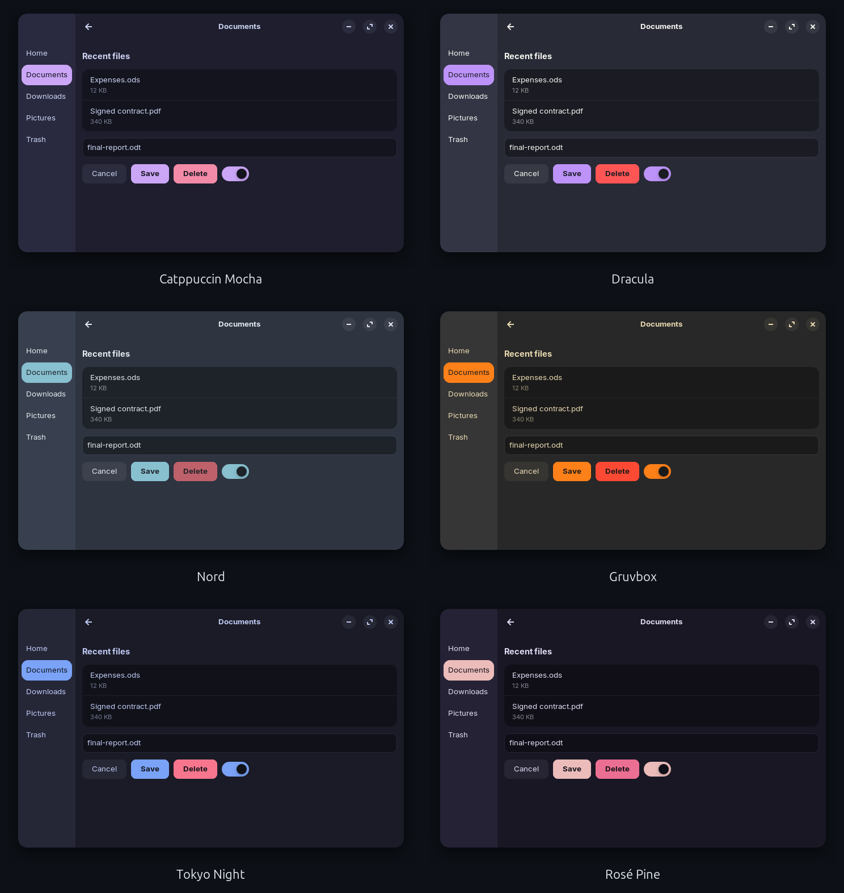
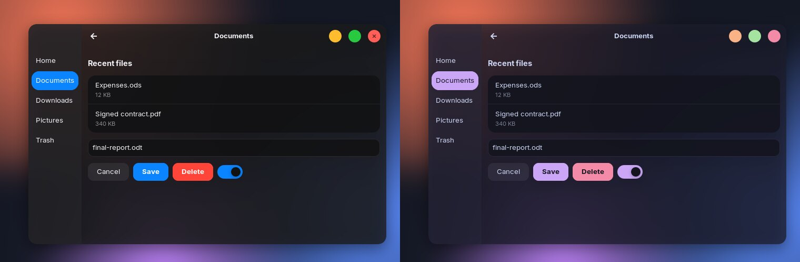
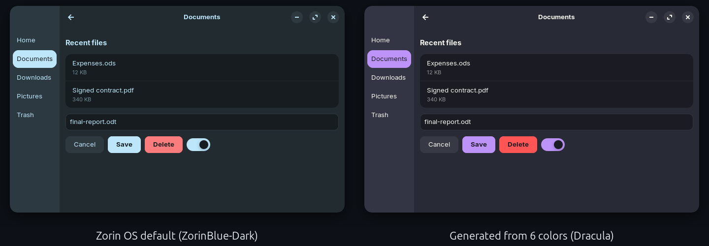
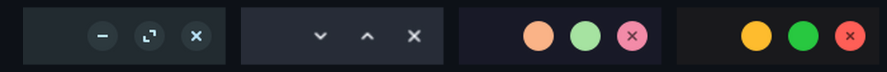
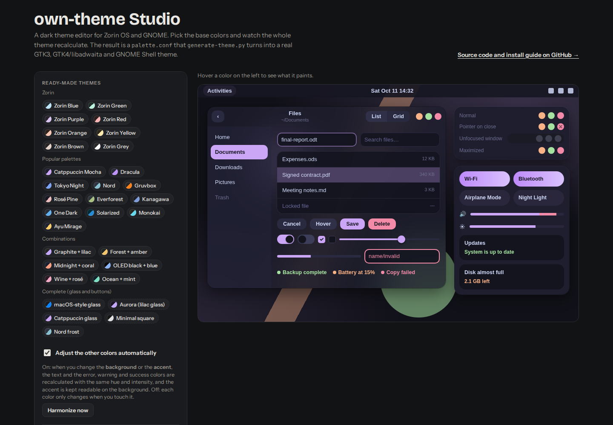
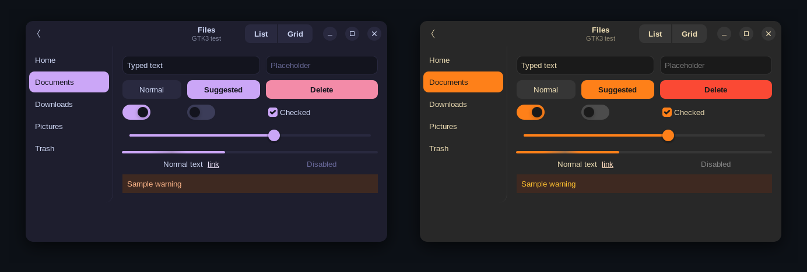

# own-theme: custom dark theme generator for Zorin OS & GNOME (GTK3, GTK4/libadwaita, GNOME Shell)

[](LICENSE)


**Make your own dark theme for Zorin OS by picking a few colors.** Choose a background, an
accent, a text color and status colors. own-theme recalculates the ~140 colors of the official
**ZorinBlue-Dark** theme and writes a complete theme for **GTK3 apps, GTK4/libadwaita apps, the
GNOME Shell** (top bar, Quick Settings, menus) and GTK2. Unlike stock Zorin, **the accent color is
independent from the background tint**.

Extras: **translucent "glass" windows with blur** (via Blur my Shell), **macOS-style or minimal
window buttons**, your **own SVG/PNG title bar icons**, and a **live visual editor** that runs in
the browser.

**[▶ Open the visual editor (live demo)](https://grs2080w.github.io/gtk-theme-generator/)**



<sub>Every screenshot here is a real GTK4/libadwaita or GTK3 window rendered with a generated theme, not a mockup.</sub>

## Features

- **6 colors → a whole theme.** Each original color belongs to a family (background, accent, text,
  text on accent, error, warning, success). Changing a family's base color moves all of its shades
  together: same hue shift, proportional saturation, remapped lightness.
- **Faithful to Zorin.** With the default `palette.conf` the output is **byte-for-byte identical**
  to ZorinBlue-Dark, and the official Green/Purple/Red/Orange variants are reproduced from just their
  two base colors, within a few RGB units.
- **Covers everything Zorin's theme covers:** GTK3, GTK4/libadwaita (Files, Settings, Text Editor…),
  GNOME Shell (top bar, overview, Quick Settings, calendar, notifications), GTK2 and the SVG assets
  (switches, checkboxes).
- **Ready-made palettes:** Catppuccin, Dracula, Nord, Tokyo Night, Gruvbox, Rosé Pine,
  Everforest, One Dark, Solarized, Monokai, Kanagawa, Ayu… (see [`examples/`](examples)).
- **Glass / glassmorphism:** translucent window, sidebar and content backgrounds, with blur
  configured automatically in the [Blur my Shell](https://extensions.gnome.org/extension/3193/blur-my-shell/)
  extension (rounded corners included).
- **Window buttons:** keep Zorin's, use colored **circles** (macOS traffic lights), **plain** symbols,
  or your own icons. Works in GTK3 and libadwaita.
- **Visual editor:** a single offline HTML page with a live desktop preview, WCAG contrast badges,
  "what does this color paint?" highlighting, an auto-harmonize mode and import/export of `palette.conf`.
- **Safe:** never touches the original Zorin themes; only overwrites folders it created itself.
- **No dependencies:** plain Python 3 standard library and Bash.

| Glass windows with blur | Before / after |
|---|---|
|  |  |

Window button styles (Zorin, plain + arrows, circles, macOS-style traffic lights):



## Requirements

- **Zorin OS 17** (GNOME 46). The generator starts from `/usr/share/themes/ZorinBlue-Dark`, which
  ships with Zorin OS.
- Python 3 (already installed).
- For the GNOME Shell part: the **User Themes** extension (enabled by default on Zorin OS).
- Optional, for blur: the **Blur my Shell** extension.

<details>
<summary>Not on Zorin OS?</summary>

The generator only needs a copy of the `ZorinBlue-Dark` theme folder, from the
[Zorin desktop themes](https://github.com/ZorinOS/zorin-desktop-themes) (GPL-3.0). Point
`OWN_THEME_SOURCE` at it:

```sh
OWN_THEME_SOURCE=/path/to/ZorinBlue-Dark python3 generate-theme.py
```

GTK3 and GNOME Shell work on any GNOME desktop. Zorin OS ships a patched libadwaita that loads
the GTK theme's `gtk-4.0` folder. On other distros, libadwaita apps ignore GTK themes unless you
copy `gtk-4.0/` into `~/.config/gtk-4.0/`.
</details>

## Quick start

```sh
git clone https://github.com/Grs2080w/gtk-theme-generator.git
cd gtk-theme-generator

# 1. pick your colors: edit palette.conf, use the editor, or copy an example
cp examples/catppuccin-mocha.conf palette.conf

# 2. generate, install to /usr/share/themes and activate
./install.sh --apply
```

The top bar changes right away. Close and reopen your apps to see the rest.

## 1. Choose the colors

### With the visual editor



Open the [online editor](https://grs2080w.github.io/gtk-theme-generator/) or the local copy
(it works offline):

```sh
xdg-open editor/index.html
```

- click a ready-made theme: Zorin variants, popular palettes, combinations, or a **complete** theme
  that also sets glass, corners and buttons;
- or pick each color yourself. With **Adjust the other colors automatically** on, changing the background
  or accent recalculates text, error, warning and success to match; turn it off for full control;
- hover a color to see what it paints in the preview, and check the contrast badges (green = readable);
- click **Copy palette.conf** and paste it over the project's `palette.conf`.

### By hand

Edit `palette.conf`. Every option:

| Option | What it changes |
|---|---|
| `name` | theme folder name (e.g. `ZorinCustom-Dark`) |
| `background` | window background; the other dark tones derive from it |
| `accent` | selection, suggested button, focus, switches, sliders |
| `text` | main text |
| `text_on_accent` | text on top of the accent; `auto` picks dark or white |
| `error`, `warning`, `success` | status colors |
| `radius` | rounded corners multiplier (`0` = square, `1` = original) |
| `window_opacity` | `0.3` to `1`; below 1 the window background (and sidebar/title bar) is translucent |
| `content_opacity` | `0.3` to `1`; the same for lists, entries and cards |
| `blur` | `yes` makes `install.sh --apply` turn on app blur in Blur my Shell |
| `blur_strength` | `0` to `100`; how much Blur my Shell blurs (default 30) |
| `blur_mode` | `static` (default): blurs the wallpaper, rounded corners; `dynamic`: blurs everything behind, but square corners on GNOME 46 |
| `buttons` | `zorin` (original), `circles` (colored dots) or `plain` (symbol only) |
| `glyphs` | symbol drawing: `lines`, `arrows` or `mac` |
| `symbols` | circles style: show the symbol `always`, on `hover` or `never` |
| `button_size` | `16` to `26` (px) |
| `button_close`, `button_maximize`, `button_minimize` | color of each button; `auto` = error, success and warning |
| `icon_close`, `icon_maximize`, `icon_minimize`, `icon_restore` | path to your own `.svg`/`.png` (relative to the conf file, no spaces) or `none`; the file becomes the whole button |

With the default values of the extra options, nothing changes in the theme.

## 2. Generate and install

**Recommended: generate, install system-wide and activate:**

```sh
./install.sh --apply                         # uses palette.conf
./install.sh --apply examples/nord.conf      # or any other palette
```

`install.sh`:
1. runs `generate-theme.py`, which builds the theme in `~/.themes/<name>`;
2. **moves** it to `/usr/share/themes/<name>` (asks for your password). This is the location
   Zorin's libadwaita reads, so GTK4 apps pick the theme up too;
3. with `--apply`, sets the GTK theme and the GNOME Shell theme and switches to dark mode.

Without `--apply` it only installs; pick the theme afterwards in Zorin Appearance or GNOME Tweaks.
For safety it refuses to overwrite any theme that was not created by this project.

**Generate only, for your user** (the theme stays in `~/.themes`):

```sh
python3 generate-theme.py                # uses palette.conf
python3 generate-theme.py other.conf     # uses another palette
python3 generate-theme.py --apply        # generate and activate from ~/.themes
```

## Glass (translucent background with blur)

GTK and GNOME Shell CSS can't blur what is behind a window, so the effect has two parts:

1. the **theme** makes the backgrounds translucent (`window_opacity`, `content_opacity`);
   text, buttons and menus stay opaque;
2. the **Blur my Shell** extension blurs what shows through. With `blur = yes`,
   `./install.sh --apply` turns on *Applications → Blur* for all apps, keeps the window itself
   opaque (the transparency comes from the theme) and uses `blur_strength`.
   To turn it off: extension preferences → Applications.

On GNOME 46 (Zorin OS 17) the extension's **dynamic** blur can't round its corners: you'd see a
square rectangle behind the window. That is why the default is **static**: the installer creates its
own pipeline in the extension (`pipeline_own_theme`: blur + corners with the same radius as the windows).

## Window buttons and custom icons

In the editor, under **Window buttons**, pick the style, colors and size, or load an SVG/PNG for each
button. Copy those files to the project's `icons/` folder with the name shown in `palette.conf`.
Templates: [`icons/example-*.svg`](icons). The essentials:

- square SVG (`viewBox="0 0 16 16"`) or a transparent 64×64+ PNG; the file is the whole button;
- no text, fonts or embedded images (Inkscape: *Object to Path* and *Stroke to Path*);
- icon sources: the *Icon Library* and *Icon Preview* apps (Flathub), Phosphor, Tabler, Lucide,
  Material Symbols; buttons from themes on gnome-look.org (WhiteSur, Orchis, Colloid…);
- alternative without a GTK theme: an icon theme in `~/.local/share/icons/` with
  `window-close-symbolic.svg`, `window-maximize-symbolic.svg`, `window-minimize-symbolic.svg`
  and `window-restore-symbolic.svg` (only applies to the `zorin` style).

Buttons work in GTK3 and GTK4/libadwaita apps. Apps that draw their own title bar
(Chrome, VS Code and other Electron apps, Qt apps) don't use the GTK theme.

## Going back to the default Zorin theme

```sh
gsettings set org.gnome.desktop.interface gtk-theme ZorinBlue-Dark
gsettings set org.gnome.shell.extensions.user-theme name ZorinBlue-Dark
```

(Use `ZorinBlue-Light` for the light theme.) To delete an installed theme:
`sudo rm -rf /usr/share/themes/<name>`.

## FAQ

**Does it work with the Zorin OS light theme?** No, own-theme only generates dark themes.

**Why can't I just edit the Zorin theme's CSS?** The Zorin theme is compiled SASS with ~140 hardcoded
colors spread over GTK3, GTK4 and GNOME Shell, and there is no SCSS source. own-theme classifies
each color and rewrites them consistently, so you don't have to.

**Where does the blur come from?** From the Blur my Shell extension. The theme only provides the
transparency.

**My theme didn't change in some apps.** Close and reopen them. Flatpak apps are sandboxed
and may not see themes installed on the host, and Electron/Qt apps don't follow GTK themes at all.

## Tools

| Script | Purpose |
|---|---|
| `tools/export-colors.py` | refreshes the color list inside the editor; run it after changing the classification in `generate-theme.py` |
| `tools/compare-variants.py` | checks the math against the official Green/Purple/Red/Orange themes |
| `tools/render-gtk3.py` | screenshots a GTK3 test window with the theme, off-screen |
| `tools/render-gtk4.py` | the same for a libadwaita (GTK4) window, via broadway; accepts the states `hover`, `backdrop`, `maximized` |

```sh
GDK_BACKEND=x11 GTK_THEME=MyTheme-Dark /usr/bin/python3 tools/render-gtk3.py test.png

gtk4-broadwayd --address 127.0.0.1 :5 &
GDK_BACKEND=broadway BROADWAY_DISPLAY=:5 GTK_THEME=MyTheme-Dark /usr/bin/python3 tools/render-gtk4.py test4.png hover
```



## How it works

Every color of the original theme belongs to a family (background, accent, text, text on accent,
error, warning, success) or is fixed (blacks, whites, shadows). When you change a family's base
color, all of its colors get the same hue shift, proportional saturation and remapped lightness.
The full write-up (color classification, CSS parsing, the glass and button rules) is in
[`docs/DEVELOPMENT.md`](docs/DEVELOPMENT.md).

## Contributing

Issues and pull requests are welcome. Please read [`docs/DEVELOPMENT.md`](docs/DEVELOPMENT.md)
first: it explains the byte-for-byte regression test and the JS ↔ Python parity rule.

## License

[MIT](LICENSE). Generated themes are derived from the Zorin OS desktop themes, which are
GPL-3.0 licensed. own-theme is not affiliated with Zorin Group or the GNOME Foundation.
